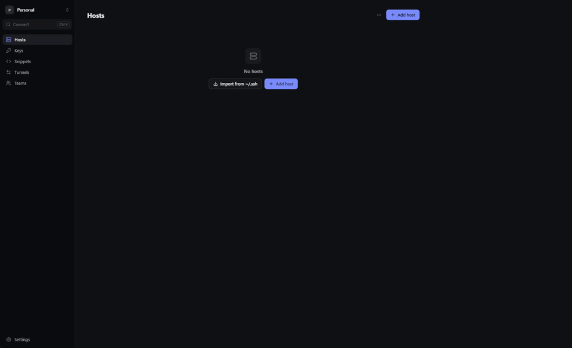
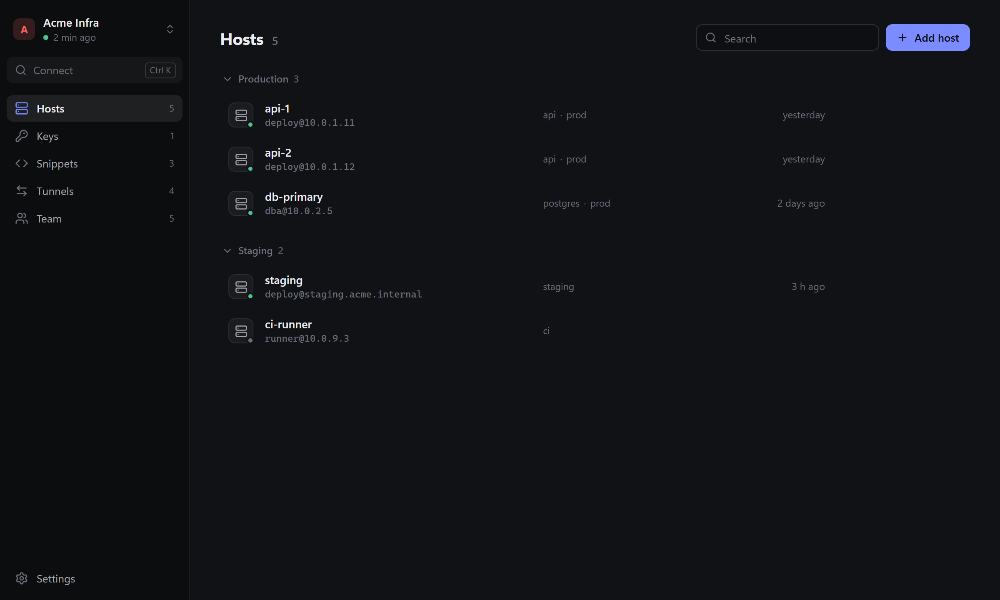
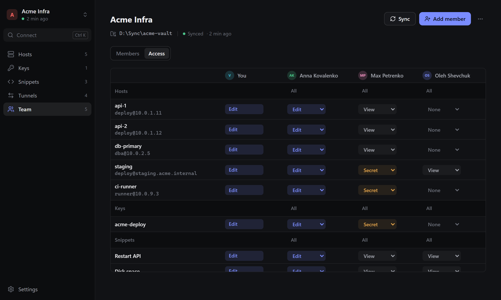

<div align="center">


# Detour

**An SSH client for teams, with no server in the middle.**

Hosts, keys and passwords are shared through a Git repository or a folder you already have,<br>
encrypted end to end and signed on every change.

[](https://github.com/INotSleep/Detour/actions/workflows/ci.yml)
[](LICENSE)


[**Download**](https://github.com/INotSleep/Detour/releases/latest) · [Docs](https://inotsleep.com/projects/detour/wiki) · [Security design](docs/teams.md) · [Build from source](#build-from-source)



</div>

## Features

- **Terminal.** Tabs, split panes, search. Copy and paste like your system terminal, or like Termius.
- **SFTP.** Files and whole folders with progress and cancel, permissions, a terminal in the current folder. A failed transfer never leaves a half-written file.
- **Tunnels.** Local (`-L`), remote (`-R`) and SOCKS (`-D`) forwarding.
- **Proxies.** Chains of jump hosts (`-J`), SOCKS5 and HTTP proxies, with logins.
- **Import.** `~/.ssh/config` with `Include`, patterns and `ProxyJump`, keys and `known_hosts`.
- **All your devices.** Your vault syncs between them. A new device joins with a one-time code.
- **Teams.** Access per host, key and snippet, per person.

<p>
  
  
</p>

## Security

Detour treats the storage, the network and every other member's computer as hostile. There is no Detour server to trust or to breach.

| If | Then |
|---|---|
| your Git host or shared folder leaks | the attacker gets ciphertext. Names, addresses, logins, members and who can see what are encrypted. |
| the storage alters, reorders, hides or rolls back changes others have seen | every member's Detour detects it and says so. |
| a teammate's copy of Detour is modified | it still holds only the keys that teammate was given. Access is enforced by encryption, not by the app. |
| someone is removed from a team | the rest of the team moves to new keys. Nothing written afterwards is readable to them. |
| your laptop is stolen | the vault is sealed with your master password and locks itself when idle. |
| a server's host key changes | the connection stops before any password or key is sent. |
| a Detour ID is swapped on its way to an admin | the fingerprints you compare don't match. |
| someone publishes a fake update | the app refuses it: updates must carry the project's signature. |

**Built on** [age](https://age-encryption.org) (X25519, scrypt), ChaCha20-Poly1305, Ed25519 signatures and per-device hash chains, [russh](https://github.com/Eugeny/russh) and [rustls](https://github.com/rustls/rustls). No accounts, no telemetry.

The full design, including what cryptography can't protect against: [docs/teams.md](docs/teams.md).

## Teams

1. Create a team in a Git repository (any SSH or HTTPS remote) or in a shared folder (Syncthing, Dropbox, OneDrive, SMB).
2. Add a teammate by the Detour ID they send you, and pick what they can see.
3. They open the same repository or folder.

## Install

Installers for macOS, Windows and Linux are on the [Releases](https://github.com/INotSleep/Detour/releases/latest) page. Detour updates itself from there.

The interface is in English and Russian.

## Privacy

Detour sends nothing to anyone except the servers, repositories and folders you set up yourself, and GitHub releases when it checks for updates (this can be turned off in Settings).

## Build from source

Requirements: Node 20+, Rust (stable), and the [Tauri prerequisites](https://tauri.app/start/prerequisites/) for your system.

```bash
npm install
npm run tauri dev        # the desktop app
npm run dev              # the UI alone in a browser, with demo data
cargo test --workspace
```

<details>
<summary>Release builds</summary>

Release builds sign their update files with the updater key: set `TAURI_SIGNING_PRIVATE_KEY` (and `TAURI_SIGNING_PRIVATE_KEY_PASSWORD` if it has one), or build without update files:

```bash
npm run tauri build -- --config "{\"bundle\":{\"createUpdaterArtifacts\":false}}"
```

CI builds the macOS and Linux installers for every `v*` tag into a draft release. The Windows ones are signed with a Certum code signing certificate in SimplySign, so they are built locally and added to that draft by `scripts/release-windows.ps1`.

</details>

### Layout

```
crates/detour-core/   SSH, SFTP, vaults, team sync, crypto. No UI dependencies.
src-tauri/            Tauri 2 shell: thin commands over detour-core
src/                  React + TypeScript UI, xterm.js terminal
  lib/api.ts          the only boundary between the UI and the core
```

## Contributing

Issues and pull requests are welcome. Contributions are published under the project's license. `cargo test --workspace` and `npx tsc --noEmit` must pass.

## License

Detour is free software under the [GNU AGPL v3](LICENSE) with the additional terms in [NOTICE](NOTICE).

Use it anywhere, including at work, at no cost. Whoever distributes a modified version, or runs one as a network service, must publish its source under the same license, credit it as **Based on Detour** with a link to this repository, and must not call it Detour.
